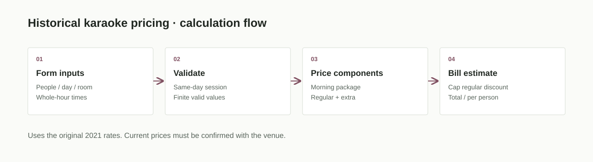

# Seisyunhu Calculator · 青春譜歷史費率計算機


用人數、場次、機種與整點時間，重現原專案的 **2021 年歷史費率**。
這是保留可操作介面的程式展示，不能作為目前店家報價。
現行消費方式請查閱 [青春譜官方網站](https://www.seisyunhu.com/) 並向店家確認。

[開啟計算機](https://natlee.github.io/seisyunhu-calculator/) · [計價規則](#historical-rates) · [測試](#開發與驗證)

## 架構與流程



靜態 HTML/CSS 提供響應式介面；`js/price.js` 的 `calculatePrice` 是純計價函式，
`calPrice` 讀取表單並顯示結果。瀏覽器即可執行，不需要伺服器或第三方彈窗套件。
費率集中在 `RATES`，不會向官網抓取或自動更新。

## 使用

直接開啟 `index.html`，或啟動本機靜態伺服器：

```bash
python -m http.server 8080
```

開啟 `http://localhost:8080`。輸入正整數人數、同日整點入退場時間、場次、
機種及每小時折價後，即可看見早場、一般場、折價與每人平均。
原本未參與計算的分鐘欄位已移除，介面明確說明只支援整點。

<a id="historical-rates"></a>
## 歷史費率

以下數值來自原版程式，並未聲稱在 2026 年仍有效。

| 場次（依入場時間） | CROSSO / G5000 每小時 | F1 / G8000 每小時 | 第四人起每人一次加價 |
| --- | ---: | ---: | ---: |
| 平日 16 時以前 | 230 | 280 | 220 |
| 平日 16 時起 | 300 | 340 | 250 |
| 假日一般場 | 340 | 420 | 280 |

假日 12 時前入場套用早場包段價，不滿三人仍收三人費用；12 時後的時數
另算一般場。即使提早離場也收完整早場包段價，不會扣出負的一般時數。

| 早場計費人數 | 每人基本價 | F1 / G8000 每人加價 |
| --- | ---: | ---: |
| 3（含不足 3 人） | 240 | 50 |
| 4 | 230 | 45 |
| 5 | 220 | 40 |
| 6 | 210 | 35 |
| 7 人起 | 200 | 30 |

一般場人頭費只在有一般場時數時收取。折價僅適用一般場，最多折至零，
不抵扣早場。平日最早 10 時、假日最早 9 時，最晚 23 時離場。
不處理跨夜、非整點、酒精加價或其他現行優惠。

## 開發與驗證

使用 Node.js 22 以上，不需要安裝套件：

```bash
npm test
```

7 項測試涵蓋機種與時段、額外人數、三人早場、早場提前離場、跨場次、
折價上限，以及不合理輸入。GitHub Actions 自動重跑。
例如平日三人 12–14 時、CROSSO/G5000 無折價，歷史估算為 460 元；
假日三人 9–11 時為早場 720 元。

本 repo 更新後仍保留封存狀態；封面為可編輯排版與歷史計價範例，
[來源與匯出方式](docs/images/cover-source.md)隨專案保存。
